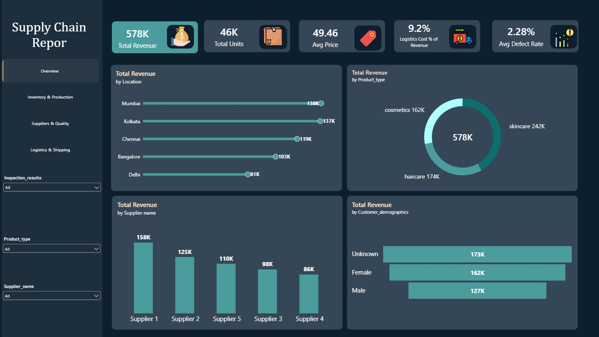
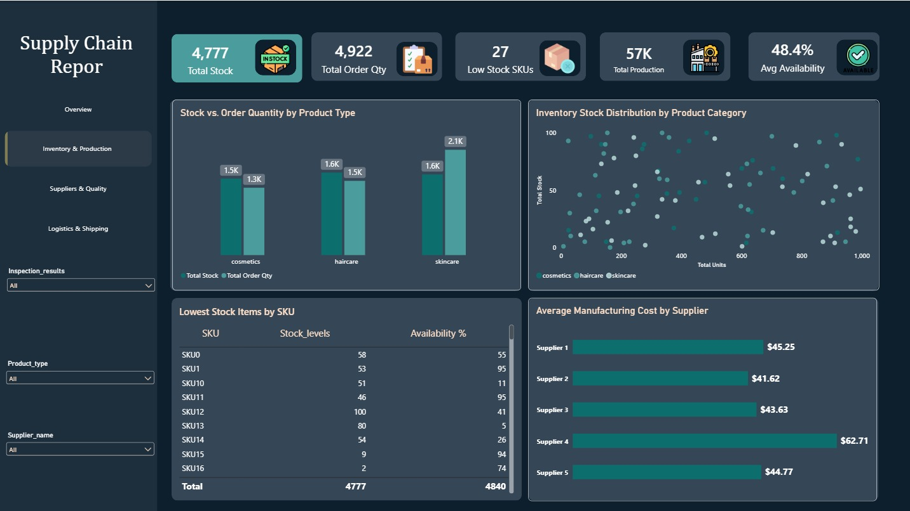
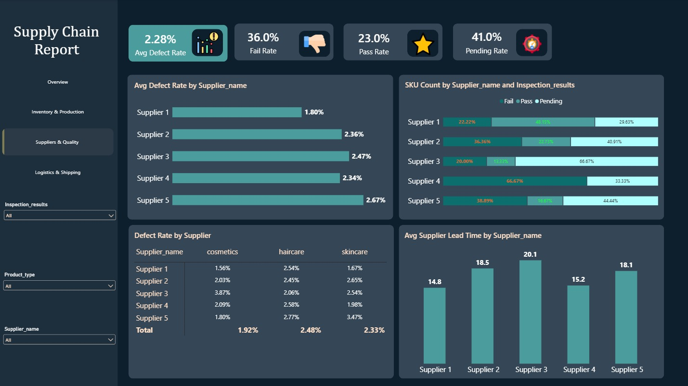
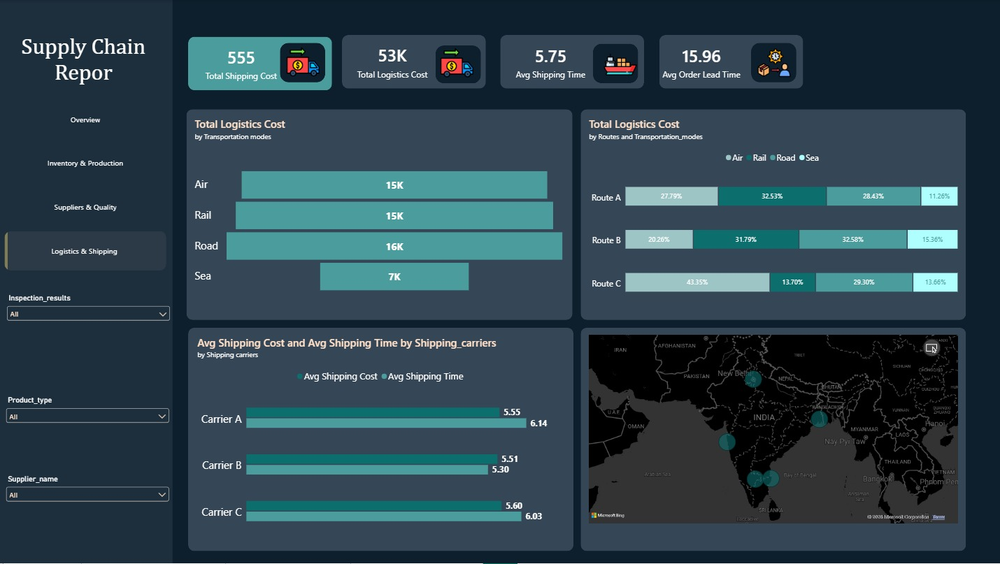

# Supply Chain Report (Power BI)

## Project Overview | نظرة عامة
An interactive 4-page Power BI report analyzing end-to-end supply chain performance for a beauty-products business (cosmetics, haircare, skincare) across five Indian cities: revenue, inventory and production, supplier quality, and logistics and shipping.

تقرير Power BI تفاعلي من ٤ صفحات لتحليل سلسلة الإمداد بالكامل: الإيرادات والمخزون والإنتاج وجودة الموردين والشحن واللوجستيات.

## Report Pages | صفحات التقرير
1. **Overview:** Total revenue, units sold, average price, logistics cost as % of revenue, and defect rate; revenue by location, product type, supplier, and customer demographics.
2. **Inventory & Production:** Stock vs. order quantity, low-stock SKU tracking, availability %, and manufacturing cost by supplier.
3. **Suppliers & Quality:** Inspection results (pass/fail/pending), defect rates by supplier and product type, and supplier lead times.
4. **Logistics & Shipping:** Logistics cost by transportation mode and route, carrier cost/time comparison, and a location map.

## Tools & Techniques | الأدوات والتقنيات
- **Power BI Desktop:** Multi-page report design with a consistent dark theme and custom KPI cards.
- **DAX measures:** Calculated KPIs such as average defect rate, availability %, logistics cost % of revenue, and lead times.
- **Data modeling:** Relationships across product, supplier, order, and inspection tables.
- **Interactive slicers:** Cross-page filtering by inspection results, product type, and supplier.

## Key Insights | أهم النتائج
- **578K** total revenue and **46K** units sold, with skincare as the top product type (**242K**).
- **Mumbai** is the top-selling location (**138K**), ahead of Kolkata (137K) and Chennai (119K).
- Average defect rate is **2.28%**; Supplier 1 has the lowest defect rate (**1.80%**) and the shortest lead time (**14.8** days), while Supplier 5 has the highest defect rate (**2.67%**).
- **27 SKUs** are at low stock, with average availability of **48.4%** against **4,922** units of order quantity.
- Road is the most expensive transportation mode (**16K** of **53K** total logistics cost); sea is the cheapest (**7K**).

## Report Preview | معاينة التقرير
### Overview

### Inventory & Production

### Suppliers & Quality

### Logistics & Shipping

## Files in this repository | ملفات المشروع
- `Supply_Chain_Report.pbix` — the full Power BI report (open it in Power BI Desktop to explore the interactive pages).
- `overview.jpg`, `inventory-production.jpg`, `suppliers-quality.jpg`, `logistics-shipping.jpg` — page previews.
